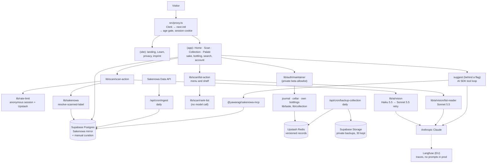

# Yawaragi 和らぎ

[](https://github.com/yawaragi-dev/yawaragi/actions/workflows/ci.yml)

A sake companion for people who can't read the label. Point the camera at a bottle, a menu or a shop shelf; Yawaragi tells you what it is, what it tastes like, and — once you have rated a few — which one on the list is for you.

**Live:** <https://yawaragi.dev> — English is live. German is on a coming-soon page until the Impressum (§5 DDG) is in place; see [ADR-0008](./docs/adr/0008-en-first-launch-strategy.md).

> *Yawaragi-mizu* (和らぎ水) is the water drunk between sake sips — a palate reset, not a replacement. This app accompanies and clarifies; it doesn't compete with the sake.

<!-- progress:start -->

## Milestone progress

_Snapshot generated 2026-10-26 from GitHub Issues + merged PRs. Regenerate with `pnpm progress`. Detail: [docs/PROGRESS.md](./docs/PROGRESS.md)._

| Milestone | Progress | Issues | ETA (median) |
| --- | --- | --- | --- |
| **M1 (Phase 0) — Compliance & i18n foundation** | `░░░░░░░░░░░░░░░░░░░░` n/a | 5 / 5 | done |
| **M2 (Phase 2) — Data foundation** | `░░░░░░░░░░░░░░░░░░░░` n/a | 11 / 12 | done |
| **M3 (Phases 3–5) — Flagship surfaces** | `░░░░░░░░░░░░░░░░░░░░` n/a | 11 / 11 | done |

<!-- progress:end -->

## What it does

**For anyone (after the 18+ gate):**

- **Scan a label.** A photo of the front, the side or the importer's German back label is read by a vision model and matched against a mirror of the Sakenowa catalogue (about 3,300 sakes). A sure match shows the sake, its brewery, a six-axis flavor chart and what the label itself says (grade, styles, polishing). Everything else gets an honest answer instead of a guess: "Best guess" with the other candidates, "Did you mean", "not in the catalogue", "not sake" (shochu, awamori, umeshu), "a menu", "several bottles", "no name on this side".
- **Type it.** Search by kanji, kana or Latin spelling.
- **The bottle page.** Flavor chart, similar sakes (cosine similarity over the six axes, no model call), the brewery and its other sakes.
- **Learn.** Eighteen hand-written entries — reading a label, the grades, polishing, nama, serving temperatures, the six flavor words — each with named sources.

**With an account (a private beta today, see [ADR-0020](./docs/adr/0020-tasting-journal-spine-and-maintainer-only-persistence.md)).** Without one, [look through a sample collection](https://yawaragi.dev/api/sample-collection?locale=en) — made-up tastings of real sakes, read-only:

- **Journal.** One-tap star rating from the scan result, quick tags, detailed notes, edit and undo.
- **Palate.** A taste profile derived from the journal, with the axes you lean towards in words.
- **Cellar.** The bottles you have at home — count, size, nama, the open bottle on a row of its own, and when a nama is best finished.
- **Your own bottlings.** The catalogue knows a sake, not its bottlings; add the one you have (grade, styles, polishing — pre-filled from the label you just scanned), and log tastings and bottles against it.
- **Menu and shelf ranking.** Photograph a drinks menu or a shop shelf; every sake on it is read, matched and ranked against your journal, with the reason in words ("Just as rich and dry, less floral").

## What is worth a look

- **Model choices are made on eval numbers.** A real-photo corpus of 202 images (bottles in shops and on tables, importer back labels, menus, shelves, shochu that looks like sake) scores every prompt and model change, from saved reads where nothing changed, so an experiment costs cents. On the full suite the cheap first tier alone (Haiku 5.5) lands on the right answer for 102 of 136 single-bottle photos, shows a wrong sake for 3, and handles all 48 menus, shelves, non-sake bottles and empty photos correctly; production adds a Sonnet 5.5 retry only where the first read is unsure. See [`evals/label-scan-jp/README.md`](./evals/label-scan-jp/README.md). A quarterly workflow opens an issue asking for the check again.
- **Every value says where it came from.** Catalogue data, deterministic math, model output, hand curation and the user's own corrections carry distinct `source` values from the schema to the screen; anything a model produced wears a "Read by AI" badge with an explanation sheet ([ADR-0005](./docs/adr/0005-source-provenance.md)).
- **Deterministic first, model second.** Similar sakes, "Did you mean", menu ranking and its reasons, and the cross-beverage bridge ("if you like Lagavulin 16…", a hand-curated table) involve no model call. The model reads photos; it does not invent mappings.
- **Privacy by design, under German rules.** A GDPR posture with a records-of-processing table updated per feature ([ADR-0009](./docs/adr/0009-gdpr-compliance-posture.md)), photos discarded after the read, no Files API, a youth-protection age gate (JMStV), and a collection with versioned records, daily backups, export, restore and erasure ([ADR-0024](./docs/adr/0024-collection-storage-versioned-records-and-backup.md)).
- **A designed product, ported screen by screen.** The Ginshu design system and its 91 reference screens live in [`design/`](./design); every port is checked against them, and [`docs/design-questions.md`](./docs/design-questions.md) is the running list of what the build asked the designers.
- **Decisions are written down.** 26 ADRs in [`docs/adr/`](./docs/adr), 166 unit test files, 8 integration suites against a real Postgres, 22 Playwright specs.
- **Open source where it is reusable.** The MCP server over the Sakenowa mirror is its own MIT package, [`@yawaragi/sakenowa-mcp`](https://github.com/yawaragi-dev/sakenowa-mcp).

Previously named "Kanpai"; renamed to avoid collision with [KANPAI London Craft Sake Brewery](https://kanpai.london/) — see [ADR-0004](./docs/adr/0004-project-name-yawaragi.md).

## Stack

- Next.js 16 (App Router, RSC by default) · TypeScript strict · Tailwind v4 + shadcn/ui
- **Ginshu** design system — a warm-ash dark palette with a ginshu (銀朱) accent, built for reading a bottle label in a dim izakaya. Tokens in `src/app/globals.css`.
- Vercel AI SDK 7 (Claude Haiku 5.5 and Sonnet 5.5) · `@ai-sdk/mcp` connecting to our own MCP server
- Supabase Postgres (catalogue) · Upstash Redis (collection, rate limits) · Clerk (auth) · Langfuse Cloud (tracing)
- next-intl (EN + DE) · Vitest + happy-dom · Playwright · testcontainers
- pnpm

## Architecture



## Status

Built: the catalogue mirror and its daily ingest, the scan with every outcome the design specifies, search, the bottle and bottling pages, Learn, and — for the private beta — the journal, Palate, Cellar, own bottlings and menu/shelf ranking. The UI matches design v1.7.1 except where [CLAUDE.md](./CLAUDE.md#design) says otherwise. Suggestions ("Ask") are built but hidden in v1 for cost and latency ([#299](https://github.com/yawaragi-dev/yawaragi/issues/299)).

Before a public launch: opening the journal to everyone (with self-service export and deletion), separate data for production and previews, the remaining vendor DPAs, and the German Impressum. See [`docs/PRE-GO-LIVE.md`](./docs/PRE-GO-LIVE.md).

## Getting started

### Prerequisites

- **Node 22+** and **pnpm 11.1.2** (the `packageManager` field pins it for `corepack enable`)
- **Docker** with a daemon reachable on the default socket (or `DOCKER_HOST` set) — required by `pnpm test:integration` / `pnpm verify`. On Linux, after installing Docker Engine, add your user to the `docker` group (`sudo usermod -aG docker $USER` then re-login). Docker Desktop, Colima, OrbStack, and rootless Docker all work; testcontainers auto-detects.

### First-run

```bash
pnpm install
cp .env.example .env.local   # fill in API keys
docker pull postgres:16-alpine   # one-time; the integration runner reuses this image
pnpm dev
```

## Commands

| Command                   | Purpose                                                  |
|---------------------------|----------------------------------------------------------|
| `pnpm dev`                | Next dev server                                          |
| `pnpm test`               | Vitest unit suite, single run                            |
| `pnpm test:watch`         | Vitest watch mode                                        |
| `pnpm test:integration`   | Vitest integration suite (testcontainers; needs Docker)  |
| `pnpm test:e2e`           | Playwright                                               |
| `pnpm lint`               | ESLint                                                   |
| `pnpm typecheck`          | `tsc --noEmit`                                           |
| `pnpm migrate`            | Apply pending SQL files in `supabase/migrations/` to `MIGRATE_DATABASE_URL` |
| `pnpm ingest`             | Refresh Sakenowa data into Supabase                      |
| `pnpm rate-limit:reset`   | Reset the anonymous rate limits in Upstash so the next scan starts at 5/5 — **every visitor's**, not just yours; says how many and asks first (`-- --bucket scan` or `suggest`, `-- --yes`) |
| `pnpm journal:export`     | Export a maintainer's collection (journal, cellar, own bottlings) to JSON — GDPR portability + durability backstop. **Output holds personal data** — gitignored; delete when done |
| `pnpm journal:restore`    | Write an export or a daily backup back into Upstash (idempotent; `--dry-run` validates only) |
| `pnpm journal:erase`      | GDPR erasure: a user's journal, cellar, own bottlings and backups (reports only without `--yes`) |
| `pnpm db:resync`          | One-shot: `db:reset --yes && migrate && ingest`          |
| `pnpm verify`             | Full chain (lint + typecheck + test + integration + e2e + audits) — **needs Docker** |
| `pnpm eval <suite>`       | Run an eval suite: `label-scan-jp`, `label-scan-pairs`, `list-read-jp`, `suggest-jp`. See `evals/<suite>/README.md` (the label scan runs offline from saved reads with `LABEL_SCAN_EVAL_OFFLINE=1`) |
| `pnpm progress`           | Refresh the milestone-progress dashboard (README block + `docs/PROGRESS.md`) |

## Project documentation

- [`CLAUDE.md`](./CLAUDE.md) — agent operating instructions, conventions, anti-patterns
- [`CONTEXT.md`](./CONTEXT.md) — domain glossary; read before naming variables/types
- [`docs/adr/`](./docs/adr) — architecture decision records
- [`docs/PRE-GO-LIVE.md`](./docs/PRE-GO-LIVE.md) — hard gates before any public launch
- [`docs/PROGRESS.md`](./docs/PROGRESS.md) — milestone-progress dashboard with ETAs, methodology, and what is NOT measured
- [`docs/deploying.md`](./docs/deploying.md) — Vercel deployment, env vars, vendor DPAs, plan-tier audit
- [`docs/NAMING-RESEARCH.md`](./docs/NAMING-RESEARCH.md) — naming decision rationale

## Open-source

The MCP server that exposes the Sakenowa-mirrored sake catalogue lives in its own repo at [`yawaragi-dev/sakenowa-mcp`](https://github.com/yawaragi-dev/sakenowa-mcp) and is consumed by this app as the npm package **`@yawaragi/sakenowa-mcp`**. v0.0.1 reserves the npm name; **v0.1.0 is in development** — six read-only tools over the Sakenowa schema, per the [spec doc](https://github.com/yawaragi-dev/sakenowa-mcp/blob/main/docs/specs/v0.1.0.md) and [issue tree](https://github.com/yawaragi-dev/sakenowa-mcp/issues). The server deliberately depends on neither Next.js nor Clerk nor any Yawaragi-specific logic, so anyone with a Sakenowa mirror in Postgres can run it standalone. See [`docs/adr/0003-mcp-server-extractability.md`](./docs/adr/0003-mcp-server-extractability.md).

## Attribution

Sake data is sourced from the [Sakenowa Data API](https://muro.sakenowa.com/sakenowa-data/api/). "Flavor Chart" is a registered trademark of Sakenowa.

## Licence

Open-core. Application code is All Rights Reserved; the cross-beverage map (CC BY-NC-SA 4.0), the glossary (CC BY-SA 4.0), and the Zod schemas (MIT) are permissively licensed. See [`docs/LICENSE-STRATEGY.md`](./docs/LICENSE-STRATEGY.md) and [`LICENSE`](./LICENSE).

The MCP server [`@yawaragi/sakenowa-mcp`](https://github.com/yawaragi-dev/sakenowa-mcp) lives in its own repo and is MIT-licensed.
