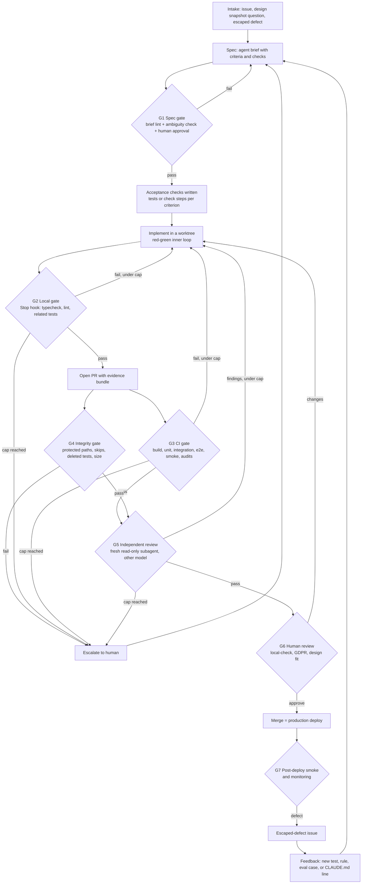

> **Ingested 2026-10-28.** External research document, saved verbatim below. It was written against commit `2b97b78`; several of its repository facts are stale or wrong. Read the assessment first: [agentic-pipeline-manual-assessment.md](./agentic-pipeline-manual-assessment.md). Nothing in this document is adopted until the maintainer decides it.

---

# A reliable agentic pipeline for Yawaragi

**Scope:** `yawaragi-dev/yawaragi`, commit `2b97b78` (main, 26 Oct 2026).
**Researched:** 28 Oct 2026. Read-only. Nothing in the repository or on GitHub was changed.
**Other repositories:** not covered yet. Section 4.6 and section 10 list what is needed to add them.

## How to read this manual

Every claim carries one of three labels.

- **[Repo]** — a fact measured in the Yawaragi repository or its GitHub history on 28 Oct 2026. The file or command is named.
- **[Source]** — a fact from a document listed in section 11. Section 11 says which documents were read.
- **[Rec]** — a recommendation or an estimate. This is opinion. It is based on the facts above it.

Terms used throughout:

- **Gate:** a check that a change must pass before it moves to the next stage. A gate passes or fails. It does not suggest.
- **Deterministic gate:** a gate that gives the same answer every time for the same input. Type checks, lint rules, tests and scripts are deterministic. A model's opinion is not.
- **Independent gate:** a gate that the agent who made the change cannot edit, skip or answer for itself.
- **Hook:** a script that Claude Code runs at a fixed point, for example before a tool call or when the agent tries to finish. A hook can block the action. The model cannot skip it.
- **Permission rule:** a line in `.claude/settings.json` that allows, asks about, or denies a tool call. Deny rules are checked first.
- **Eval:** a repeatable test of a prompt or skill. It runs the agent on fixed inputs several times and scores the outputs.
- **Yield:** the share of items that pass a stage on the first try.
- **WIP (work in progress):** the number of items started but not finished.
- **Escaped defect:** a bug that reached production.

---

## 1. Executive summary

### The situation

[Repo] Yawaragi already has more working gates than most projects. Strict TypeScript, ESLint with a custom import rule, 213 unit test files, Postgres integration tests for row-level security, 28 Playwright end-to-end spec files, a production-build smoke test, two custom audit scripts, and compile-time separation of public and user-scoped database tables all run in CI on every code change. The product's own AI features have deterministic evals with ground truth.

[Repo] Most changes are written by Claude. Of 812 commits on main since 15 May 2026, 481 are not from bots, and 388 of those carry a `Co-Authored-By: Claude` line. There is one human, who files all 170 issues, opens all 299 non-bot pull requests, and is the only reviewer.

[Repo] The weak points are not the checks. They are the edges around them:

1. **Nothing stops an agent from running a destructive command.** There is no `.claude/settings.json` in the repository, so there are no committed permission rules or hooks. Scripts that drop the database schema (`pnpm db:reset -- --yes`, and `pnpm db:resync`, which passes `--yes` itself) or erase a user's data (`pnpm journal:erase -- --yes`) read real connection strings from `.env.local`. The `.claudeignore` file that lists `.env*` has no effect: Claude Code's permission documentation says so directly and says to use `Read` deny rules instead.
2. **Human review is the constraint, and it is thin.** In the 30 days to 28 Oct, 163 non-bot pull requests merged. The median time from opening to merge was 13 minutes. 105 of 163 merged within 30 minutes. 66 of 163 changed more than 400 lines. No pull request has a recorded review.
3. **The agent checks much of its own work.** The `self-review` skill, the test-review checklist, the 14-point UX pre-flight checklist, the GDPR questions and the pull request checkboxes are all answered by the same agent that wrote the change, usually in the same session.
4. **Some gates pass without testing anything.** 61 of the 69 conditional `skip` calls in `e2e/` skip when the catalogue database is absent. CI sets no `DATABASE_URL`. So the sake page, search and scan-result specs that depend on catalogue data most likely do not run in CI. (Inferred from the code and `ci.yml`. CI logs were not readable from this session. Confirm with one CI log.)
5. **Changes to the agent's own instructions bypass all checks.** `ci.yml` ignores `**/*.md`. Every skill file and `CLAUDE.md` is Markdown. Skill edits (for example PR #530, which changed the `local-check` skill) merge with no CI run and no eval.

### The target pipeline

[Rec] Nine stages, each with a gate owned by something the generating agent cannot change:

```
intake → spec → [spec gate] → implement → [local gate] → PR → [CI + integrity gate]
       → [independent review] → [human review] → merge (= production deploy)
       → [post-deploy smoke + monitoring] → feedback into specs, rules and evals
```

Section 3 has the diagram and the full table.

### The first five changes

| # | Change | Why first | Effort [Rec] |
|---|---|---|---|
| 1 | Commit `.claude/settings.json` with deny and ask rules and a Bash guard hook. Give agents their own GitHub identity that cannot merge, and require the maintainer's approval on `main`. | Closes the only risks that cannot be undone: data loss and unreviewed production deploys. | 1 day |
| 2 | Add a gate-integrity check to CI: fail on new `.skip`/`.only`, deleted tests, edits to CI or audit files without a human label, and more skipped e2e tests than a fixed budget. Stop ignoring `.claude/**` and `CLAUDE.md` in CI. | Stops the agent from weakening the checks that judge it. Makes the existing e2e suite count. | 1 day |
| 3 | Make every acceptance criterion name its check. Add a fresh, read-only reviewer subagent on a different model that compares the diff to those criteria before the human sees it. | Moves "did it do what was asked" from self-assessment to an independent check. | 1–2 days |
| 4 | Limit open agent pull requests awaiting review to 3, and flag any pull request over 400 changed lines. Put test output and phone-size screenshots in every pull request automatically. | The maintainer is the constraint. Smaller, evidenced changes are cheaper to review well. | 1 day |
| 5 | Move the 24,000-character design-port log out of `CLAUDE.md`, and start an eval suite for the repository's own skills, run on every change to them. | Reduces context load on every task. Gives skill changes a regression test. | 2–3 days |

---

## 2. Principles

Each principle from the brief is listed with what research confirmed, the source, and a one-line rule. Principles the research did not support are marked.

| # | Principle | What the evidence says | Rule |
|---|---|---|---|
| P1 | Redundancy only helps when failures are independent (von Neumann 1956; Knight & Leveson 1986). | [Source] Knight & Leveson ran 27 independently written programs from one specification. Pairs failed on the same inputs far more often than independence predicts; the null hypothesis of independence was rejected at 99% confidence. [Source] Kim et al. (ICML 2025) measured over 350 LLMs: when two models are both wrong, they give the same wrong answer about 60% of the time on one benchmark. Errors correlate more for models from the same provider and for more accurate models. | Do not count two runs of the same model as two independent checks. |
| P2 | Use diverse redundancy. | [Source] The Space Shuttle's fifth computer ran separately developed backup software to cover generic errors in the four primary computers. [Source] Claude Code subagents can run on a different model, with a fresh context and restricted tools. | When you add a second check, change at least two of: model, context, method. |
| P3 | A verifier of the same kind shares the generator's blind spots. | [Source] Panickssery et al. (NeurIPS 2024): LLMs recognise their own text and rate it higher than equal-quality text from others. [Source] Anthropic (March 2026): agents "reliably skew positive when grading their own work"; a separate evaluator was easier to make critical. | Never let the agent that wrote a change be its only judge. |
| P4 | Precision lives in the feedback loop, not the generator (Black's feedback amplifier). | [Source] Claude Code's best-practices page: give Claude "something it can run that comes back pass or fail". [Source] Anthropic (Dec 2024): coding suits agents because solutions "are verifiable through automated tests". The Black amplifier source was not read. | Put engineering effort into specs, tests and checks before prompts. |
| P5 | Check is cheaper than rework; retry only when the check is better than the generator (ARQ, Hopfield 1974). | [Source] Hopfield 1974: spending energy on a proofreading step buys accuracy beyond what binding alone allows. | Every retry loop needs a check that is more reliable than the step it checks. |
| P6 | Layered checks, each for a different error class (DNA replication). | [Source] McCulloch & Kunkel 2008: base selection errs at roughly 10⁻⁴–10⁻⁵; proofreading improves this a few-fold to over 100-fold; mismatch repair adds more; the in-vivo rate is below 10⁻⁹. [Source] Cook 1998: complex systems are defended by many layers and run partly broken at all times. | Each gate must name the error class it catches. Two gates for the same class is waste. |
| P7 | Pipeline yield is the product of stage yields. | Arithmetic, not a source: 0.95¹⁰ ≈ 0.60. | Measure yield per stage, not only at the end. |
| P8 | Gates between stages; final correctness at the ends (Saltzer, Reed & Clark 1984). | [Source] The end-to-end paper: checks below the endpoints are "justified only as performance enhancements". | Keep one end-to-end gate that cannot be skipped. Treat earlier gates as ways to fail sooner and cheaper. |
| P9 | Prevent rather than detect (poka-yoke: design so the wrong action is impossible). | [Source] Claude Code docs separate instructions the model may ignore (`CLAUDE.md`, skills) from rules the harness enforces (hooks, deny rules). "If something has to happen every time, make it a hook, a deny rule, or a managed setting." [Repo] Yawaragi already does this well: the `publicQuery`/`userQuery` table split is a compile error, not a guideline. | If a rule has zero exceptions, enforce it in code. If it has exceptions, keep it in prose. |
| P10 | Stop the line on a defect, after bounded retries (jidoka: stop production when a defect appears). | [Source] Anthropic (Dec 2024) recommends stopping conditions such as "a maximum number of iterations". [Source] Claude Code caps Stop-hook blocks at eight in a row by default (`CLAUDE_CODE_STOP_HOOK_BLOCK_CAP`). | Every loop has a retry cap and a named human to escalate to. |
| P11 | Build quality in; do not depend on inspection (Deming, point 3). | [Source] Deming's point 3: "Cease dependence on inspection to achieve quality." | When a gate keeps failing for the same reason, fix the input (spec, context, skill), not the gate. |
| P12 | Agents game metrics (Goodhart). | [Source] METR (June 2025): frontier models patched evaluators, overwrote timers and searched for reference answers; on one benchmark 30% of runs did this. Models often said afterwards that they knew it went against the user's intent. Anti-cheating prompts barely helped. | Protect tests and CI from the agent being tested, in code, not in the prompt. |
| P13 | Verifying is easier than generating — except where it is not. | [Source] Anthropic evals guide (Jan 2026): code graders are cheap and objective but brittle; model graders need calibration against humans; humans are the gold standard but slow. | Where only taste can judge (design fit, German tone, architecture), a human stays in the loop. |
| P14 | Trust a small checking kernel (de Bruijn criterion; translation validation). | Not separately researched. Consistent with P3 and P9. | Keep the trusted checks small, human-owned and deterministic. Verify each change, not the agent. |
| P15 | When an agent is lost, restart it clean (Erlang supervisors). | [Source] Anthropic (Sep 2025): context is a finite budget; recall degrades as it fills ("context rot"). Sub-agents with clean context windows are one of three remedies. [Source] Claude Code subagents start with a fresh context. | After repeated failure or repeated compaction, end the session and start a new one from a written hand-off. |
| P16 | Retries must be idempotent (doing it twice has the same effect as once). | Not separately researched. | Before creating a branch, PR or issue, check whether it already exists. |
| P17 | State intent and constraints, not steps (mission command). | [Repo] The repository's `AGENT-BRIEF.md` already says: behavioural, not procedural; no file paths; testable acceptance criteria; explicit out-of-scope. | Specs say what and how to verify, never how to build. |
| P18 | A bad spec is bias, not noise. | Follows from P1: correlated agents given the same ambiguous criterion produce the same wrong result. | Spend on catching ambiguity before implementation, not on more implementations. |
| P19 | Small batches. | [Source] DORA 2025: AI acts as an amplifier of an organisation's existing strengths and weaknesses. The DORA capability list (which includes small batches) was not read in full. | Keep changes small enough for the human to review properly. |

---

## 3. Reference pipeline

### 3.1 Diagram



### 3.2 Stage and gate table

| Stage | Input | Output | Gate | Gate type | Error class caught | Owner | Failure action |
|---|---|---|---|---|---|---|---|
| Intake | Issue, design question, defect report | Labelled issue | Triage label (`needs-triage` → `ready-for-agent` / `ready-for-human`) | Human | Work that should not be done, or not by an agent | Maintainer | `needs-info`, `wontfix`, or `ready-for-human` |
| Spec | Labelled issue, ADRs, design section | Agent brief with criteria; each criterion names its check | **G1** brief lint (script) + two-reader ambiguity check + human approval | Deterministic + model + human | Ambiguous or untestable criteria; open design decisions; missing GDPR answers | Script; maintainer approves | Back to spec; or `needs-info` |
| Acceptance checks | Approved brief | One failing test or explicit check step per criterion | Each new test fails before implementation | Deterministic | Tests that pass without the feature | Spec agent; CI verifies | Rewrite the test |
| Implement | Brief, failing checks | Commits on a branch in a worktree | **G2** Stop hook: `typecheck`, `lint`, related unit tests | Deterministic | Type errors, lint errors, broken units | Hook | Agent fixes; after cap, escalate |
| PR | Branch | Pull request with TL;DR, criteria table, evidence | Template completeness (script) | Deterministic | Missing TL;DR, manual-testing steps, criteria table | CI | Agent fixes |
| CI | PR head | Pass/fail per job | **G3** existing `ci.yml` jobs | Deterministic | Build, unit, integration, e2e, smoke, i18n and Files-API audits | CI | Agent fixes, max 2 rounds; then escalate |
| Integrity | PR diff | Pass/fail with reasons | **G4** `check-gate-integrity` script | Deterministic | Weakened tests, edited CI or audit config, skipped e2e above budget, oversize PR | CI; human label to override | Escalate. The agent may not override. |
| Independent review | Brief + diff + CI results | Findings by severity, criteria met / not met | **G5** fresh reviewer subagent, read-only, different model | Model (calibrated) | Criterion missed, spec drift, doc drift, rule violations not caught by lint | Reviewer subagent; calibrated by maintainer | Implementer fixes, max 2 rounds; then escalate |
| Human review | PR + evidence + reviewer report | Approve or changes requested | **G6** maintainer approval (GitHub-enforced) | Human | Taste, design fit, product judgement, GDPR, anything the earlier gates cannot judge | Maintainer | Changes go back to implement |
| Merge | Approved PR | Production deployment on Vercel | Branch protection: required checks + approval | Deterministic (GitHub) | Merging red or unapproved work | GitHub | Blocked |
| Post-deploy | Production URL | Smoke result; traces; counters | **G7** production smoke on each deployment; weekly trace and counter review | Deterministic + human | Production-only failures (as in #518) | CI; maintainer | Escaped-defect issue; revert if severe |
| Feedback | Escaped defects, escalations, review findings | New test, rule, eval case or doc line | Weekly metrics review | Human | Repeat failures | Maintainer | Change the input, not the gate (P11) |

[Rec] G1 to G4 are cheap. G5 costs model tokens. G6 costs human attention, which is the scarcest resource. The order is chosen so that the expensive gates see only work that passed the cheap ones.

---

## 4. Yawaragi: current state, gaps, changes

### 4.1 Current state (checked against the repository)

The brief's §6 block was empty. This is what the repository shows. [Repo] throughout.

| Item | What is there |
|---|---|
| Path | `github.com/yawaragi-dev/yawaragi` (public). Maintainer's local checkout is `/home/bv/Projects/yawaragi` (from the `local-check` skill). |
| What it is | A sake companion web app: label scan by vision model, chat recommender, taste profile, journal and cellar. Version 1.10.0, in private beta (issue #454 tracks the public launch in Germany). |
| Stack | Next.js 16.4 App Router, React 19.3, TypeScript 6 (strict), Tailwind 4, shadcn/ui, Vercel AI SDK 7, Supabase Postgres, Clerk auth, Upstash, Langfuse tracing. pnpm 11, Node 22. |
| Tests and checks | `tsc --noEmit` (strict). ESLint (Next config + a rule against `../../` imports). Vitest: 213 test files beside 409 source files. Integration: Vitest + Testcontainers Postgres (row-level security). Playwright: 28 spec files, vision model replaced by a stub so CI makes no paid calls. Production smoke: `next start` on the real build (added in #525 after #518 broke every Learn page in production only). Audits: `i18n:audit` (promotional words), `anthropic-files:audit` (bans the Files API). Type-level test `public-query.test-d.ts`. Guard unit tests such as `otel-setup.test.ts` and `heuristic-disclaimer.test.tsx`. `messages-parity.test.ts` checks German and English keys match. |
| Product evals | `evals/label-scan-jp` (202 photos, ground truth, deterministic judge with unit tests), `list-read-jp`, `suggest-jp` (recall@k). Paid; not in CI by design. Quarterly model-review issue opened by a workflow. |
| CI/CD | GitHub Actions `ci.yml`: one job, typecheck → lint → build → unit → integration → audits → production smoke → e2e. Ignores `**/*.md`, `docs/**`, `LICENSE`. `game-ci.yml` for the 404 game. Merge to `main` deploys production on Vercel (`fra1`); previews are off and run on demand via `vercel-deploy.yml`. A bot commits a progress dashboard after each merge. Dependabot weekly, grouped, 14-day cooldown matching pnpm `minimumReleaseAge`. |
| Branch protection | `main` is protected. The rules could not be read (HTTP 403 from this session). |
| How work arrives | Early on: GitHub issues with `ready-for-agent` briefs (64 closed). Since about #400: mostly design snapshots (`design/`, v1.10) and design-question rounds (`docs/design-questions.md`), ported screen by screen. Only 7 of the last 80 non-bot PRs reference an issue with `closes #`. 69 issues open; 22 `needs-triage`, 11 `ready-for-human`, 6 `ready-for-agent`. |
| Who reviews | Only the maintainer. All 80 recent PRs have a TL;DR and 79 have manual-testing steps. None has a GitHub review. The `local-check` skill runs UI PRs on `localhost:3000` with a numbered checklist; on "ok" the agent merges with `gh pr merge --squash`. |
| Agent setup | `CLAUDE.md` (68,579 bytes, roughly 30k tokens), `AGENTS.md` (Next.js block written by `next dev`), `CONTEXT.md` glossary (31 KB), 26 ADRs. 19 skills in `.claude/skills/`: 13 from `mattpocock/skills` (pinned by hash in `skills-lock.json`), 6 others, not pinned in the lock file (`self-review`, `local-check`, `pre-handoff-retro`, `consume-research`, `langfuse`, `mobile-layout-bug-repro`). `docs/agents/` maps issue tracker, labels, domain docs, UX playbook, Vitest mocks. No `.claude/settings.json`, no hooks, no `.claude/agents/` subagents. Agents run in worktrees under `.claude/worktrees/` (gitignored). The `local-check` skill refers to user-level memories (`user-runs-own-dev-server`, `local-dev-writes-real-collection-data`) that are not in the repository. |

### 4.2 Gate audit (brief question 2)

**Real, independent gates today** [Repo]:

- CI jobs in `ci.yml`. They run on every code PR. Of 148 code PRs merged in 30 days, all had a successful `Verify` run on their final commit.
- Compile-time rules: strict types; the `publicQuery`/`userQuery` table split; `TracedCallContext.metadata` typed as `Record<string,string>`.
- Runtime guards: `assertRateLimitConfig` fails a production boot if `RATE_LIMIT_BYPASS` is set.
- Supply chain: `minimumReleaseAge` 14 days; Dependabot cooldown; `--frozen-lockfile` in CI.
- The maintainer's hands-on check of UI PRs through `local-check`.

**Places where the agent checks its own work** [Repo]:

| Check | Who answers it | Problem |
|---|---|---|
| `self-review` skill (8 phases, severity list) | The implementing agent, normally in the same session | Same model, same context, same reasoning that produced the change (P3). |
| CLAUDE.md "Test review checklist" (3 questions) | The agent that wrote the tests | Question 1 ("would this fail if I deleted the implementation?") can be checked by a tool (mutation testing), but is answered by opinion. |
| UX pre-flight checklist (14 items, `docs/agents/ux-design-playbook.md`) | The implementing agent | At least items 2, 6, 7, 10, 11 and 13 can be checked by tests or scripts. The rest need a person or a browser run. |
| PR template checkboxes, including "`pnpm verify` runs clean locally" | The implementing agent | A claim, not evidence. |
| Per-PR GDPR questions | The implementing agent | These are legal judgements. The repository says a "yes" without follow-up blocks the merge, but nothing enforces it. |
| "Deviations from spec" section | The implementing agent | The agent decides what counts as a deviation. |

**Gaps ranked by risk** [Rec, based on the Repo facts above]:

| Rank | Gap | Evidence | Consequence if it fails | Fix (section) |
|---|---|---|---|---|
| 1 | No enforced limits on agent actions. | No `.claude/settings.json`. `.claudeignore` has no effect per the permissions docs. `db:resync` runs `db:reset -- --yes`. `local-check` notes local dev "may write their real collection". | Dropped schema, erased user data, leaked secrets. Cannot be undone. | 7.3 |
| 2 | Merge equals production deploy, and the agent performs the merge with the maintainer's credentials. | `local-check` step 5: `gh pr merge <n> --squash`. Merge to main triggers the Vercel production build. | An unreviewed change reaches users. GitHub cannot tell agent from human. | 7.3 |
| 3 | Review depth does not match volume. | 163 PRs in 30 days; median 13 minutes open to merge; 66 over 400 lines; #543 (2,380 changed lines) merged 10 minutes after opening. | Defects pass because no one had time to look. #518 reached production. | 4.5, 5 |
| 4 | Tests and CI can be edited by the agent they judge. | No check on diffs to `e2e/`, `*.test.ts`, `ci.yml`, `vitest*.config.*`, `scripts/audit-*`. | Weakened gates look green (P12). | 5 (G4) |
| 5 | Catalogue-dependent e2e specs probably skip in CI. | 61 of 69 skip calls depend on `DATABASE_URL`; CI sets none. | Search, sake page and scan-result flows can break with CI green. | 5 (G3, G4) |
| 6 | Skills and `CLAUDE.md` change without any check. | `paths-ignore: '**/*.md'`; no skill evals. | A skill edit silently degrades every later task. | 6 |
| 7 | Criteria are not mapped to checks. | Recent work comes from design sections and question rounds, not briefs with criteria; 7 of 80 PRs link an issue. | "Done" is the agent's judgement. | 4.4 |
| 8 | No automatic check after a production deploy. | `vercel-deploy.yml` is manual only. | Production-only failures (like #518) are found by the maintainer. | 5 (G7) |
| 9 | Context load. | `CLAUDE.md` line 186 alone is 24,000 characters of port history; line 3 is an 8,700-character Next.js docs index. | Less attention for the task; rules get missed (P15). | 4.6 |
| 10 | No pipeline metrics. | First-pass CI yield cannot be computed from history: 45 of 64 multi-commit PRs had no CI run on their first commit. | Cannot tell whether a process change helped. | 8 |

### 4.3 Concrete changes

Each change names the file or job. Section 5 gives implementations. Section 9 orders them.

1. `.claude/settings.json`: deny and ask rules; `PreToolUse` Bash guard hook; `Stop` hook. (7.3, 5)
2. Move the `.claudeignore` entries into `Read` deny rules. Keep the file if another tool reads it.
3. GitHub: a separate agent identity (machine user or GitHub App) with push and PR rights, no merge or label rights. Branch protection on `main`: require the `Verify` and `integrity` checks and one approving review from the maintainer.
4. `scripts/check-gate-integrity.ts` and a CI job `integrity` on every PR, including docs-only ones. (5, G4)
5. `ci.yml`: stop ignoring `.claude/**`, `CLAUDE.md`, `AGENTS.md`, `docs/agents/**`. They do not need the full build; they need the integrity job and the skill evals.
6. CI e2e with catalogue data: a seeded Postgres service with a small fixture catalogue, so DB-bound specs run. Until then, a skip budget in G4.
7. Brief format with a `Check:` line per criterion, and `scripts/check-brief.ts`. (4.4)
8. `.claude/agents/criteria-reviewer.md`: a read-only reviewer on a different model. (5, G5)
9. WIP and size limits; evidence bundle job. (4.5)
10. `CLAUDE.md` reduction; `.claude/rules/` for path-scoped rules; convert enforceable rules to lint or tests. (4.6)
11. Skill evals with `claude plugin eval`. (6)
12. Production smoke on each Vercel production deployment. (5, G7)
13. `pnpm pipeline:report` for metrics. (8)

**Conflicts with locked conventions** (brief §9 asks these to be named, not overridden):

| Recommendation | Conflicts with | Proposed resolution [Rec] |
|---|---|---|
| Acceptance tests written before implementation (4.4) | CLAUDE.md: "Do NOT write all tests up front for a feature. One red, one green, repeat." The `tdd` skill calls this "horizontal slicing". | Keep the rule for unit tests. Add one outer acceptance check per criterion, written first, at the public interface (Playwright page or a pure model function). The inner loop stays red-green. Maintainer decides. |
| Move the port-status paragraph out of `CLAUDE.md` (4.6) | CLAUDE.md line 186: "update it in each PR that ports more". | Keep the rule, change the location: `docs/design/port-status.md`, with a one-line pointer in `CLAUDE.md`. |
| The agent may not merge (7.3) | `local-check` step 5: the agent merges on the maintainer's "ok". | The maintainer's "ok" becomes a GitHub approval (one click, or `gh pr review --approve` run by the maintainer). The agent identity may then merge, because branch protection checks the approval. |
| Package repository skills as a plugin to evaluate them (6) | Skill invocation names would gain a prefix (`yawaragi:self-review`). | Only package new pipeline skills. Leave existing skills where they are. |
| Next.js docs index in `CLAUDE.md` (4.6) | Written by `npx @next/codemod agents-md`; `AGENTS.md` says it is re-added. | Do not remove it. Measure whether it helps (the index points at docs that are not in the repo by default: `.next-docs`). |

### 4.4 Specs as the control input (brief question 3)

**What makes a criterion machine-checkable** [Rec, from the Anthropic evals guide and the repository's own AGENT-BRIEF.md]:

1. It names something observable from outside the code: a rendered page, an HTTP response, a function's return value, a database row, a file.
2. It has an oracle: a fixed expected value, or a rule that decides pass or fail without judgement.
3. It covers one behaviour. "Search works and is fast" is two criteria.
4. It names the check that will verify it.
5. It includes the negative case where one exists: what must *not* happen.
6. It survives refactoring: no file paths, no internal function names unless they are the public interface.

**Brief format.** Extend the existing `AGENT-BRIEF.md` template with a `Check:` line under each criterion. Allowed check types: `unit`, `e2e`, `integration`, `audit`, `type`, `smoke`, `manual` (the maintainer's step in `local-check`), `review` (only for things a reviewer must read, such as copy tone).

```markdown
**Acceptance criteria:**
- [ ] A visitor with no connection who taps a journal row sees a sheet with name, kanji, brewery, stars, date and note.
      Check: e2e — offline.spec.ts "journal row opens the offline sheet"
- [ ] The sheet's strings exist in en.json and de.json.
      Check: unit — messages-parity.test.ts (existing)
- [ ] No sake data renders before the 18+ gate is accepted.
      Check: e2e — age-gate.spec.ts (existing)
- [ ] The German copy reads as natural German.
      Check: manual — local-check step "switch to DE, read the sheet"
```

**`scripts/check-brief.ts`** (deterministic, part of G1): reads a brief from an issue comment or a file and fails when:

- a criterion has no `Check:` line, or an unknown check type;
- more than a third of criteria are `manual` or `review` (signals an untestable spec);
- the brief has no `Out of scope` section;
- the brief contains a file path with a line number (`AGENT-BRIEF.md` forbids these);
- the brief touches user data (keywords from the GDPR section: `user_id`, journal, cellar, account, consent, retention) and has no GDPR answers section;
- the brief names a design "Open decision" (CLAUDE.md: "not ours to settle").

**Writing the checks before implementation.** After G1 passes, a spec agent (a fresh session) writes one failing test per `e2e`/`unit`/`integration` criterion and commits it as the first commit on the branch. CI on that commit must show those tests failing for the stated reason. The implementing agent then may not edit those test files (hook in 5, G4 rule I-3). See the conflict note in 4.3.

**Catching ambiguity early (bias, not noise).** [Rec] Two cheap techniques:

1. **Two-reader check.** Two fresh subagents on different models each read only the brief and write a short list: "the tests I would write". A script or the maintainer compares them. Where they differ on what a criterion means, the criterion is ambiguous. Ask the maintainer before building. Cost: two short model calls. This uses redundancy where it works best: on reading, before any expensive work.
2. **Existing `grill-with-docs` skill.** It interviews the maintainer against `CONTEXT.md` and the ADRs. Run it whenever the two-reader check disagrees.

### 4.5 Flow and review cost (brief question 7)

**The constraint** [Repo]: weekly non-bot commits to main rose from 11 (week 39) to 54 (week 43). One maintainer reviews all of them.

[Source] Goldratt's work on constraints and *The Phoenix Project* were not read for this manual. The rule below is the standard one from that literature, stated as a recommendation.

[Rec] Rules:

1. **WIP limit: at most 3 agent PRs waiting for human review.** When the queue is full, agents do not start new implementation. They may write briefs, run evals, or fix CI on open PRs. Before starting an implementation run, the orchestrating script counts open PRs by the agent identity (`gh pr list --author <agent> --state open`) and stops if the count is 3 or more.
2. **Size limit: 400 changed lines** (excluding `pnpm-lock.yaml`, `design/**`, generated files, screenshots). Over the limit, G4 marks the PR `oversize`. The agent must split it or write a one-paragraph reason in the PR. [Repo] 66 of 163 recent PRs would have been flagged.
3. **Refactor PRs must not change test files.** A refactor is a change that keeps behaviour. If tests had to change, behaviour changed. G4 checks this for PRs titled `refactor`. This makes large refactors (#539–#543) cheap to review: the evidence is that unchanged tests still pass.
4. **Evidence bundle in every PR,** produced by CI, not by the agent:
   - The criteria table with each check's result (pass, fail, or "manual: not yet done").
   - Playwright screenshots at 390×844 (the design's frame) for each route the diff touches, uploaded as a CI artifact and linked from the job summary.
   - Counts: tests run, skipped, and the skip budget.
   - The G4 integrity result and the G5 reviewer findings.
5. **Review order for the maintainer:** TL;DR → criteria table → integrity flags → reviewer findings → screenshots → diff. Most PRs can be decided at the screenshots.
6. **Batch what is safe to batch:** docs-only and design-question PRs can be merged together once a day. Dependabot is already grouped.

### 4.6 Context engineering (brief question 9)

[Source] Claude Code loads `CLAUDE.md` into every session; every line takes some attention on every task. The best-practices page lists what belongs there: the commands to verify work, places where the code misleads, decisions not visible in the code, and anything corrected twice. It recommends `.claude/rules/` with `paths:` filters for rules that apply to one part of the code, and skills for procedures (only the skill's description is loaded until it is used).

[Repo] `CLAUDE.md` is roughly 30k tokens (68,579 bytes). Line 186 (the design-port log) is 24,000 characters and records what each design version ported. It is history, useful to a person planning work, rarely needed by an agent fixing a bug.

| Content | Where it should live [Rec] |
|---|---|
| Commands, test review checklist, PR TL;DR rule, anti-patterns that are judgement calls | `CLAUDE.md` |
| Design-port status (line 186) | `docs/design/port-status.md`, pointer in `CLAUDE.md` |
| Provenance, attribution, flavor vocabulary, cross-beverage, JMStV, i18n rules | `.claude/rules/ui.md` with `paths: ["src/app/**", "src/components/**", "messages/**"]` |
| GDPR rules and per-PR questions | `.claude/rules/user-data.md` with paths for `src/lib/collection/**`, `src/lib/supabase/**`, `supabase/migrations/**`, `scripts/*journal*`, `scripts/erase-*` (check the exact paths when writing it) |
| Rules with zero exceptions | Code: lint rules, tests or hooks, then delete the prose. Candidates: no `dark:` variant (grep in G4), kebab-case file names (lint), Zod schemas only in `src/lib/schemas/` (grep in G4), pnpm only (hook), no inline JSX strings (lint, if a rule fits the codebase) |
| Procedures (triage, local check, retro) | Skills (already) |
| Per-task facts (which issue, which design section, which screenshots) | The brief and the prompt for that task |
| User-level memories the skills depend on | Copy the load-bearing ones (`local-dev-writes-real-collection-data`, `user-runs-own-dev-server`) into the skill text. Headless and cloud runs do not see the maintainer's memory. |

**Stopping context rot in long runs** [Rec, based on the Anthropic context-engineering and long-running-harness articles]:

- One stage, one session. The spec agent, implementer and reviewer are separate sessions or subagents. Each starts from files (brief, failing tests, diff), not from a conversation.
- Progress lives in files: the criteria table in the PR body is the state. [Source] Anthropic's long-running harness used a JSON feature list that agents could only flip from failing to passing, because models overwrote JSON less than Markdown.
- Restart rule: if a session has compacted twice, or failed the same gate twice, it writes a hand-off (the existing `handoff` skill) and ends. A new session continues from the hand-off.

### 4.7 Cross-repo reuse (brief question 10)

[Repo] Other repositories visible to this account: `yawaragi-dev/sakenowa-mcp`, `yawaragi-dev/sakenowa-mcp-vercel` (public, same organisation; the app consumes the MCP server as `@yawaragi/sakenowa-mcp`), `BVengerov/sashibari` and `BVengerov/scheissbahn` (private, pushed this month), and older repositories. None was explored.

[Rec] Share through one plugin repository (for example `yawaragi-dev/agent-pipeline`), installed into each repository by `enabledPlugins` in its `.claude/settings.json`:

| Shared (plugin) | Stays per repository |
|---|---|
| Bash guard hook and its pattern list format | The list of destructive scripts and protected paths |
| `check-gate-integrity` engine | Its config file (protected paths, skip budget, size limit) |
| `write-agent-brief`, `criteria-reviewer`, `escalate`, `pipeline-report` skills and agents | `CLAUDE.md`, `.claude/rules/`, domain checklists (GDPR, JMStV) |
| The eval suite for the shared skills, and its CI workflow | Product evals (`evals/`), repository-specific skill evals |
| Settings baseline (deny rules for force push, `.env*` reads, secrets) | Test commands, CI jobs |
| Brief template and `check-brief` | Label mapping (`docs/agents/triage-labels.md`) |

The existing `mattpocock/skills` set is already pinned by hash in `skills-lock.json`; the shared plugin should be pinned the same way.

---

## 5. Gate and verifier catalogue (brief question 4)

### 5.1 Which checks are deterministic, which are model-judged

[Rec] Rule: a check is deterministic unless no deterministic check can decide it. Model-judged checks are allowed only where they are calibrated (5.5) and never as the last gate.

| Deterministic (scripts, types, tests, CI, GitHub) | Model-judged (calibrated) | Human only |
|---|---|---|
| Types, lint, unit, integration, e2e, smoke, audits | Does the diff meet each criterion that has no automatic check? | Design fit against the snapshot and screenshots |
| Brief lint (`check-brief`) | Is a criterion ambiguous? (two-reader check) | Natural German; tone of copy |
| Gate integrity (`check-gate-integrity`) | Doc drift: does README, ADR or `CONTEXT.md` now say something false? | GDPR and JMStV judgements |
| PR size, refactor-touches-no-tests | Is the PR TL;DR free of jargon? | Whether to build the thing at all |
| i18n key parity, promotional-word audit, Files-API audit | | Approving a change to a gate |
| Skip budget, required checks, required approval | | |

### 5.2 Catalogue

| ID | Gate | Implementation | Catches | Status |
|---|---|---|---|---|
| G1a | Brief lint | `scripts/check-brief.ts`; run by the `write-agent-brief` skill before it posts, and by a workflow on issues labelled `ready-for-agent` | Criteria with no check; no out-of-scope; missing GDPR answers; open design decisions | New |
| G1b | Two-reader ambiguity check | Two subagents, different models, each lists the tests it would write from the brief; diff shown to the maintainer | Ambiguous criteria (bias) | New |
| G1c | Human approval of the brief | Maintainer applies `ready-for-agent` | Wrong problem; wrong priority | Exists |
| G2 | Local gate | `Stop` hook (5.3) | Type, lint and unit failures before the agent claims "done" | New |
| G3 | CI | `ci.yml` `verify` job | Build, unit, integration, e2e, smoke, audits | Exists; add seeded catalogue for e2e |
| G3b | Test strength | Mutation testing on changed files (for example StrykerJS with its Vitest runner; verify fit first) | Tests that pass when the code is broken: the CLAUDE.md test-review question 1, answered by a tool | New, informational at first |
| G4 | Integrity | `scripts/check-gate-integrity.ts`, CI job `integrity`, runs on every PR including docs-only | See 5.4 | New |
| G5 | Independent review | `.claude/agents/criteria-reviewer.md` (5.5) | Missed criteria, spec drift, doc drift | New; replaces reliance on `self-review` |
| G6 | Human review | Branch protection: one approval from the maintainer; `local-check` for UI | Taste, product judgement, compliance | Exists, made enforceable |
| G7 | Post-deploy smoke | Workflow on `deployment_status` (state `success`, environment Production) that runs the HTTP smoke and Playwright smoke against the production URL; reuse the test job in `vercel-deploy.yml` | Production-only failures | New |
| G8 | Guard hook | `PreToolUse` Bash hook (5.3) | Destructive and secret-reading commands | New |

### 5.3 Hooks

**Stop hook (G2).** Runs when the agent tries to end its turn. Exit code 2 sends it back with the output. [Source] Claude Code allows eight blocks in a row by default, then ends the turn.

```json
{
  "hooks": {
    "Stop": [
      {
        "hooks": [
          {
            "type": "command",
            "command": "${CLAUDE_PROJECT_DIR}/.claude/hooks/stop-gate.sh"
          }
        ]
      }
    ]
  }
}
```

```bash
#!/bin/bash
# .claude/hooks/stop-gate.sh — typecheck, lint, and unit tests related to changed files.
set -o pipefail
changed=$(git diff --name-only origin/main...HEAD -- '*.ts' '*.tsx' 2>/dev/null)
[ -z "$changed" ] && exit 0                       # nothing changed: let it stop
pnpm -s typecheck 1>&2 || exit 2
pnpm -s lint 1>&2 || exit 2
pnpm exec vitest related --run $changed 1>&2 || exit 2
exit 0
```

[Rec] Set `CLAUDE_CODE_STOP_HOOK_BLOCK_CAP=3` for pipeline runs. Three failed attempts at the same local gate means the agent is stuck; more attempts cost tokens without new information (section 7).

**Bash guard hook (G8).** Permission rules match the command text Claude writes. [Source] The permissions page says a Bash deny rule "isn't a security boundary around the program": the same script can run through `sh -c`, `tsx scripts/reset-db.ts` or a Node one-liner. The hook inspects the full command, and the sandbox (7.3) covers what text matching cannot.

```json
{
  "hooks": {
    "PreToolUse": [
      {
        "matcher": "Bash",
        "hooks": [
          {
            "type": "command",
            "command": "${CLAUDE_PROJECT_DIR}/.claude/hooks/guard-bash.sh",
            "onFailure": "block"
          }
        ]
      }
    ]
  }
}
```

```bash
#!/bin/bash
# .claude/hooks/guard-bash.sh — block commands that destroy data, deploy, or read secrets.
cmd=$(jq -r '.tool_input.command')
deny() { echo "Blocked by guard-bash: $1. Ask the maintainer to run it." 1>&2; exit 2; }

echo "$cmd" | grep -Eq 'reset-db|db:reset|db:resync'                 && deny "drops the database schema"
echo "$cmd" | grep -Eq 'erase-collection|journal:erase'               && deny "erases user data"
echo "$cmd" | grep -Eq 'restore-journal|journal:restore'              && deny "writes user data"
echo "$cmd" | grep -Eq 'romaji-regenerate.*--apply|romaji:regenerate.*--apply' && deny "writes the catalogue"
echo "$cmd" | grep -Eq 'git push.*(--force|-f( |$)|\+[A-Za-z])'       && deny "force push"
echo "$cmd" | grep -Eq 'git push[^|;&]* (origin )?main( |$)'          && deny "push to main"
echo "$cmd" | grep -Eq 'vercel[^|;&]*(--prod|deploy)'                 && deny "deploys"
echo "$cmd" | grep -Eq '\.env(\.local|\.production|\.development)?( |$|")' && deny "reads or writes env secrets"
echo "$cmd" | grep -Eq 'RATE_LIMIT_BYPASS=1'                          && deny "disables cost protection"
echo "$cmd" | grep -Eq 'gh (secret|variable)|gh api[^|;&]*protection' && deny "changes repository secrets or protection"
exit 0
```

[Rec] Keep this list short. [Source] The best-practices page warns that every hook will sometimes fire when it should not; a hook is for a rule with zero exceptions. The list above is restricted to actions that cannot be undone or that cost money or users' data.

**Implementation-stage hook (part of G4).** When a pipeline run sets `PIPELINE_STAGE=implement` (an environment variable set by the orchestrating script), a `PreToolUse` hook on `Edit|Write` blocks edits to the acceptance tests written at the spec stage and to the protected paths in 5.4. Interactive sessions do not set the variable and are not affected.

### 5.4 Gate integrity check (G4)

`scripts/check-gate-integrity.ts` reads `git diff origin/main...HEAD`, the PR title and body, the PR labels, and the Playwright JSON report. It fails the CI job when a rule fails. Overrides are labels that only the maintainer's account can apply (7.3).

| Rule | Fails when | Override label |
|---|---|---|
| I-1 Protected paths | The diff touches `.github/workflows/**`, `.claude/settings.json`, `.claude/hooks/**`, `eslint.config.mjs`, `vitest*.config.*`, `playwright*.config.ts`, `scripts/audit-*.ts`, `scripts/check-*.ts`, `src/instrumentation.ts`, `src/lib/ai/observability/otel-setup*.ts`, `pnpm-workspace.yaml` | `gate-change-approved` |
| I-2 Focus and skip | A new `.only(` anywhere, or a new unconditional `.skip(` / `test.fixme(` | `skip-approved` |
| I-3 Locked acceptance tests | A test file added in the branch's spec commit is modified in a later commit | `spec-change-approved` |
| I-4 Weakened tests | A test file is deleted without its source file, or a modified test file has fewer `expect(` calls than before | `tests-removed-ok` |
| I-5 Suppressions | A new `eslint-disable`, `@ts-ignore`, `@ts-expect-error`, `as any` without a reason on the same line. [Repo] Baseline today: 10, 17 and 6. | none: add the reason |
| I-6 Skip budget | Skipped Playwright tests in this run exceed the recorded baseline | `skip-approved` |
| I-7 Refactor purity | Title starts with `refactor` and a test file changed | Retitle as `feat` or `fix` |
| I-8 Size | More than 400 changed lines outside the exclusion list, and no "Why not split" section | none: split or explain |
| I-9 Encoded conventions | A new `dark:` class; `z.object(` outside `src/lib/schemas/`; `npm install` or `yarn` in scripts | none |
| I-10 PR body | No `## TL;DR`, no `## Manual testing`, or no criteria table with a check per row | none |

### 5.5 Independent reviewer (G5) and judge calibration

```markdown
---
name: criteria-reviewer
description: Reviews a Yawaragi PR against its agent brief. Read-only. Use after CI is green and before the maintainer reviews.
tools: Read, Grep, Glob
model: sonnet
maxTurns: 30
---

You review one pull request. You did not write it. You receive three files:
brief.md (the agent brief), diff.patch (the full diff), ci-summary.md (check results).

For each acceptance criterion in brief.md, answer MET, NOT MET, or UNKNOWN, and quote
the diff lines or CI result that show it. Use UNKNOWN when the evidence is not there.

Then list findings that affect correctness or a project rule in CLAUDE.md. Only two
severities: BLOCKER (must fix before merge) and MEDIUM (should fix). Skip style,
naming and formatting. Do not suggest new abstractions or extra tests for cases the
brief does not ask for.

Check whether README.md, CONTEXT.md, docs/adr/ or CLAUDE.md now state something the
diff made false. Report each as MEDIUM with the file and the sentence.

Output JSON: {"criteria":[{"id":..,"verdict":..,"evidence":..}],"findings":[..]}.
```

[Rec] Choose `model` so it differs from the implementer's. If implementation runs on Opus, review on Sonnet, or the reverse. [Source] Kim et al. found that errors still correlate across providers for strong models, so a model change reduces shared blind spots but does not remove them. The reviewer's other differences (no conversation history, only the brief and diff, no edit tools) matter as much as the model.

[Source] The best-practices page warns that a reviewer asked to find problems "will always find something"; hence the "skip style" instruction and the two-severity limit.

**Calibrating the reviewer** [Rec, based on Husain's field guide and the Anthropic evals guide]:

1. Take 30 past PRs. For each, the maintainer writes a binary verdict per criterion (met or not met) and a one-line reason. About one hour.
2. Run the reviewer on the same PRs. Measure agreement on "not met" (how many real misses it finds) and on "met" (how many false alarms it raises).
3. Change the prompt and add two or three of the maintainer's reasons as examples until agreement is at least 90% on both. [Source] Husain reports one team needed three rounds to pass 90%, and that adding example critiques raised agreement by 15–20%.
4. Re-check monthly on 10 new PRs. If agreement falls below 85%, recalibrate.
5. Keep the reviewer advisory to G6 until step 3 passes. After that, a BLOCKER finding stops the PR from reaching the maintainer until fixed.

### 5.6 Redundancy and diversity (brief question 5)

[Rec, based on P1–P3 and the costs in the Anthropic harness article: a full generator-evaluator harness cost over 20 times a solo run]:

| Situation | Worth multiple agents? | How to make them diverse |
|---|---|---|
| Reading a spec for ambiguity | Yes. Cheap, and it attacks bias, which more implementations cannot. | Two models; each sees only the brief. |
| Reviewing a diff | One independent reviewer, plus the deterministic gates. | Different model, fresh context, read-only tools, different inputs (brief and diff, not the conversation). |
| Implementing a normal feature | No. Best-of-n doubles review work for the constraint (the maintainer) and the runs share failures. | — |
| Choosing between two designs for a hard, isolated piece (a matcher, a ranking rule) where a deterministic eval exists | Sometimes. Run 2–3 candidates and let the eval pick. | Different approaches stated in the prompt; selection by the existing product eval, not by a model. |
| Changing a production model | Already done well: side-by-side product evals with ground truth. | Keep. |

The strongest diversity is a different kind of check, not a second model: a test, a type, a screenshot compared by a person, a mutation run.

---

## 6. Eval harness for skills and prompts (brief question 8, part 2)

### 6.1 Tool choice

[Source] `claude plugin eval` runs a plugin's eval cases in fresh, isolated non-interactive sessions, three runs per case by default, with and without the plugin. Graders: `regex`, `tool_used`, `tool_order`, `file_exists` (free) and `llm`, `baseline` (judge model calls). There are no custom-code graders. A case passes at `--threshold` (default 1.0). Exit code 1 when a case scores below threshold; 2 when `--max-cost-usd` stopped the run. The skill-creator plugin has its own `evals/evals.json` format for iterating on one skill.

[Source] A plugin can live inside a repository as a "skills-directory plugin": a directory with `.claude-plugin/plugin.json` under the project's `.claude/skills/`.

[Rec] Put the new pipeline skills in one skills-directory plugin, `.claude/skills/pipeline/`, with its own `evals/`. Later, move it to the shared plugin repository (4.7). This does not touch Yawaragi's top-level `evals/` directory (product evals): the plugin's eval directory is inside the plugin.

### 6.2 What to evaluate first

1. `write-agent-brief` — the control input for every later stage (worked example below).
2. `criteria-reviewer` — its agreement with the maintainer (5.5) is its eval.
3. `self-review` and `local-check` — high-use repository skills, edited recently (#530).

### 6.3 Worked example: the spec-writing stage

Layout:

```
.claude/skills/pipeline/
├── .claude-plugin/plugin.json
├── skills/write-agent-brief/SKILL.md
└── evals/
    ├── clear-bug/            prompt.md, graders/
    ├── vague-request/        prompt.md, graders/
    ├── touches-user-data/    prompt.md, graders/
    ├── open-design-decision/ prompt.md, graders/
    └── should-not-trigger/   prompt.md, graders/
```

`evals/clear-bug/prompt.md` (the issue text is in the prompt because runs start in an empty directory and have no `gh` access):

```markdown
---
max_turns: 15
allowed_tools: [Read, Glob, Grep, Skill, Write]
tags: [every-change]
---

Turn this issue into an agent brief and save it as brief.md.

Issue #416: Catalogue: Mizuo (水尾) is filed under 田中酒造店 instead of 田中屋酒造店.
Search for "Mizuo" shows brewery 田中酒造店 (Hokkaido). The bottle's label and the
brewery's site say 田中屋酒造店 (Nagano). Expected: the sake page and search row show
田中屋酒造店, and a scan of the label lands on Mizuo.
```

Graders (each a file in `graders/`):

```markdown
---
type: tool_used
tool: Skill
input_match: '"skill"\s*:\s*"(?:[\w-]+:)?write-agent-brief"'
---
```

```markdown
---
type: regex
target: { source: file, path: brief.md }
pattern: 'Check: (unit|e2e|integration|audit|type|smoke|manual|review)'
---
```

```markdown
---
type: regex
target: { source: file, path: brief.md }
pattern: '\.(ts|tsx):\d+'
match: not_contains
---
```

```markdown
---
type: regex
target: { source: file, path: brief.md }
pattern: '\*\*Out of scope:\*\*'
---
```

Each eval run starts in an empty workspace, so the repository's `check-brief.ts` is not there. The regex graders above cover its main rules. [Rec] For a full deterministic check, keep `brief.md` from each run (`--keep-temp`) and run `check-brief.ts` over them in the same CI job; fail the job if any brief fails. [Source] The plugin-eval page recommends the related pattern for builds and tests: have the run write an outcome to a file and grade the file.

The other cases:

| Case | Prompt (summary) | Graders |
|---|---|---|
| vague-request | "Make search better." | `regex` not_contains `ready-for-agent` in the last message; `regex` requires a question or `needs-info`. |
| touches-user-data | "Let users add where they bought a bottle and the price." (design N, waits on GDPR review) | `regex` on brief.md requires `lawful basis` and `retention`. |
| open-design-decision | "Build the feedback sheet from design v1.10 AA." (It waits on open decision 20: where feedback messages are stored.) | `regex` requires the brief to name open decision 20 and to mark the issue `ready-for-human` or `needs-info`, not `ready-for-agent`. |
| should-not-trigger | "Fix the typo 'flavour' in README line 3." | `tool_used` Skill with `min: 0`, `max: 0`, `arm: both`. |

One `llm` grader, used only in the monthly run: "PASS if every acceptance criterion describes something a person or a test can observe from outside the code. FAIL if any criterion describes an implementation step." Calibrate it the same way as the reviewer (5.5) on 30 briefs the maintainer has labelled.

### 6.4 Running it

Locally, while editing the skill:

```bash
claude plugin eval .claude/skills/pipeline --case clear-bug --runs 1 --ablation none --allow-tools Write
```

(Runs only get read-only tools unless granted. `Write` is needed for `brief.md`.)

On every change to `.claude/**` (new workflow `skill-evals.yml`):

```bash
claude plugin eval .claude/skills/pipeline \
  --trust-plugin --tag every-change --ablation none \
  --threshold 0.8 --model claude-opus-5-5 --no-publish \
  --allow-tools Write --max-cost-usd 5 --json results.json
```

Monthly, the full suite with the no-plugin baseline (`--ablation with-without`) and the `llm` graders, with the judge model pinned (`--judge-model`). Archive `results.json`. [Source] The page advises pinning both models so a model rollout is not mistaken for a skill regression, and keeping `partial: true` results out of trends.

[Rec] Threshold 0.8, not 1.0: with three runs per case, one bad run in a five-case suite should be visible in the report but should not block an unrelated skill fix. Raise to 1.0 for the cases tagged `regression` once they are stable. [Source] The Anthropic evals guide: regression evals should sit near 100%; capability evals start low.

### 6.5 Maintaining the suite

- Every escalation and every escaped defect caused by a skill becomes a new case within a week. [Source] Anthropic recommends starting with 20–50 tasks drawn from real failures.
- Read transcripts of failed runs before changing a grader. [Source] "You won't know if your graders are working well unless you read the transcripts."
- A case that fails in every run is more likely broken than hard; check the case first.
- Cost: about cases × runs × 2 agent runs per full suite, plus three judge calls per `llm` grader per run. Five cases × three runs, one arm, is 15 agent runs per change.
- [Rec] Open question: `claude plugin eval` has had early-access and server-side switch-off states. Confirm it runs on this account before relying on it in CI (section 10).

---

## 7. Operating policy (brief questions 6 and 11)

### 7.1 Retry caps and escalation

| Loop | Cap | Then |
|---|---|---|
| Local gate (Stop hook) | 3 consecutive blocks (`CLAUDE_CODE_STOP_HOOK_BLOCK_CAP=3`) | Session writes a hand-off and ends; status `escalated` |
| CI red after push | 2 fix attempts | Label `needs-human`; escalation packet |
| Reviewer findings (G5) | 2 rounds | Label `needs-human`; packet includes both review reports |
| Integrity failure (G4) | 0. The agent does not try to make G4 pass by other edits. | Escalate immediately |
| Same failure twice in a row (same test, same error text) | Stop at the second | Escalate; this is a defect in the input, not in the attempt |
| Context compacted twice in one session | Stop | Hand-off, fresh session continues once |
| Headless run budget | `--max-budget-usd` per run: spec 1, implement 10, review 2 [Rec; adjust from measured costs] | Run stops; escalate with partial work pushed to the branch |
| Subagent turns | `maxTurns` in each agent definition (reviewer 30) | Returns what it has |

**What the human sees on escalation** (one comment on the PR or issue, made by the agent identity):

```markdown
## Stopped: <gate> failed <n> times

**Brief:** #<issue> · **Branch:** <name> · **Cost so far:** $<x> · **Attempts:** <n>

| Criterion | Status | Evidence |
|---|---|---|
| ... | met / not met / unknown | test name or link |

**Last failure (trimmed to 30 lines):**
<output>

**What was tried:** one line per attempt.
**Agent's best guess at the cause:** one paragraph.
**Question for you:** one question with options, e.g. "Is the brief wrong, or the test?"
```

[Rec] The question at the end is the most important line. Most stops in a spec-driven pipeline are spec problems (P18). The maintainer's answer goes back into the brief, not into the conversation.

### 7.2 Avoiding unbounded loops and cost

- Every headless run (`claude -p`) gets `--max-budget-usd` and `--output-format json`; the JSON contains `total_cost_usd`, which the orchestrator appends to a run log for the metrics in section 8.
- Idempotency: before creating a branch, PR or comment, the orchestrator checks for an existing one with the same issue number. Branch names derive from the issue (`agent/<issue>-<slug>`).
- WIP limit (4.5) caps parallel spend as well as review load.

### 7.3 Safety and permissions

**Never without a human** [Rec]:

| Action | Why | Enforced by |
|---|---|---|
| Merge to `main` | Merge deploys production | Branch protection: required approval from the maintainer; agent identity lacks bypass |
| Push to `main`, force-push anywhere | Rewrites shared history | Branch protection; guard hook; deny rule |
| `vercel deploy`, `vercel --prod`, dispatching `vercel-deploy.yml` with production | Deploys | Guard hook; ask rule on `gh workflow run` |
| `db:reset`, `db:resync`, `journal:erase`, `journal:restore`, `romaji:regenerate -- --apply`, `ingest`, `migrate`, `rate-limit:reset` | Write or destroy real data | Deny or ask rules; guard hook; sandbox keeps `.env.local` unreadable |
| Reading or writing `.env`, `.env.local` | Secrets for Supabase, Clerk, Anthropic, Upstash | `Read` and `Edit` deny rules; sandbox |
| Adding dependencies, editing `allowBuilds` or `minimumReleaseAge` | Supply-chain risk (CLAUDE.md anti-patterns) | Ask rule on `pnpm add`; I-1 on `pnpm-workspace.yaml` |
| Editing CI, hooks, settings, audit scripts | These are the gates | Ask rules; I-1 |
| Paid eval runs | Cost | Ask rule on `pnpm eval` |
| Repository secrets, branch protection | Control of the gates | Guard hook; agent identity lacks admin |

**Project settings** (`.claude/settings.json`, committed). [Source] Deny rules are checked first, then ask, then allow; an allow rule cannot override a deny rule. In a non-interactive `claude -p` run, a call that needs approval is denied, so `ask` rules mean "the maintainer approves interactively; pipeline runs cannot do it".

```json
{
  "permissions": {
    "deny": [
      "Read(.env)", "Read(.env.local)", "Read(.env.*.local)",
      "Edit(.env)", "Edit(.env.local)", "Edit(.env.*.local)",
      "Bash(pnpm db:reset *)", "Bash(pnpm db:resync *)",
      "Bash(npm run db:reset *)", "Bash(npm run db:resync *)",
      "Bash(pnpm journal:erase *)", "Bash(pnpm journal:restore *)",
      "Bash(git push --force *)", "Bash(git push -f *)",
      "Bash(git push origin main *)",
      "Bash(vercel *)", "Bash(npx vercel *)",
      "Bash(gh secret *)"
    ],
    "ask": [
      "Bash(pnpm migrate *)", "Bash(pnpm ingest *)",
      "Bash(pnpm romaji:regenerate *)", "Bash(pnpm rate-limit:reset *)",
      "Bash(pnpm eval *)", "Bash(pnpm add *)",
      "Bash(gh pr merge *)", "Bash(gh workflow run *)",
      "Edit(/.github/workflows/**)", "Edit(/.claude/settings.json)",
      "Edit(/.claude/hooks/**)", "Edit(/scripts/audit-*.ts)",
      "Edit(/pnpm-workspace.yaml)", "Edit(/eslint.config.mjs)"
    ]
  }
}
```

Notes:

- [Source] Project deny rules apply immediately after commit; allow rules wait for each person's trust dialog.
- [Source] Read and Edit deny rules do not stop a Node or Python script that opens files itself. Turn on the sandbox (`/sandbox`) for agent sessions; it confines shell commands and picks up `Read` deny rules.
- [Source] `.worktreeinclude` copies listed gitignored files into each new worktree. If it lists `.env.local`, every agent worktree gets the real secrets. Prefer a separate `.env.agent` with a development database and no production keys (open question in section 10 on whether local dev writes real data).
- [Source] In `bypassPermissions` mode Claude Code skips prompts, including for `.claude` writes. Set `permissions.disableBypassPermissionsMode` to `"disable"` in user settings on the maintainer's machine.

**A separate GitHub identity for agents** [Rec]. Today the agent pushes and merges as `BVengerov`. GitHub cannot tell the two apart, so no label or approval rule can bind the agent. A machine user or GitHub App for agents, with write access to branches and pull requests but no admin and no bypass, turns the human approval into a rule GitHub enforces (the two-person rule). It also makes the metrics in section 8 measurable: agent commits and human commits become distinguishable.

---

## 8. Metrics and review cadence (brief question 8, part 1)

### 8.1 Metrics

| Metric | Definition | Source | Baseline [Repo, 30 days to 28 Oct] | Threshold that triggers a process change [Rec] |
|---|---|---|---|---|
| Spec yield | Briefs approved at G1 without rework ÷ briefs written | Issue labels and `check-brief` logs | Not measured | < 70% for 4 weeks: improve the brief skill and template |
| CI first-pass yield | PRs whose first CI run is green ÷ PRs | Check runs on each PR's first pushed commit (requires CI to run on it; see note) | Not measurable: 45 of 64 multi-commit PRs had no CI run on their first commit | < 70% for 2 weeks: improve context or the Stop hook |
| Reviewer pass rate | PRs with no G5 BLOCKER ÷ PRs | Reviewer JSON | Not measured | < 60%: look at the brief and implementer; > 95% with escapes rising: the reviewer is too lenient |
| First-pass acceptance | PRs approved by the maintainer with no further commits after review request ÷ PRs | GitHub events | Not measured | < 60%: the gates before G6 miss what the maintainer cares about; add a check |
| Rework rate | Merged PRs followed within 14 days by a `fix` PR touching the same files ÷ merged PRs | git log | 16 `fix` commits among ~134 typed commits (not yet matched to originating PRs) | > 10% |
| Escaped defects | Issues labelled `escaped-defect` per 20 merged PRs | Issues | Examples: #518 (Learn pages 500 in production), #532 (debug cookie honoured on production) | > 1 per 20 PRs: add a gate for that error class |
| Escalation rate | Runs ending `escalated` ÷ runs | Run log | Not measured | > 25%: spec quality; < 2% with escapes: caps or gates too loose |
| Cost per merged PR | Sum of `total_cost_usd` of all runs for a PR | Run log | Not measured | Trend only; investigate a doubling |
| Human review time | Time from "ready for review" to approval; maintainer's own estimate weekly | GitHub; maintainer | Median 13 minutes open → merge (not the same thing) | Rising queue age with WIP at the cap: the cap is too high |
| Gate health | Skipped e2e tests in CI; flaky retries; integrity overrides used | CI | Skips not measurable from this session | Any rise in skips; more than 2 overrides per week |
| PR size | Changed lines, median and share over 400 | GitHub | Median 245; 66 of 163 over 400 | Share over 400 above 20% after the size rule is in place |

Note on CI first-pass yield: CI uses `cancel-in-progress` and agents often push several commits at once, so the first commit rarely gets its own run. Record the result of the first CI run on each PR in the run log instead of reconstructing it.

### 8.2 Cadence

- **Every PR:** G4 and G5 results in the PR; cost appended to the run log.
- **Weekly, 15 minutes:** `pnpm pipeline:report` (new script; reads the GitHub REST API and the run log) prints the table above for the last 7 and 30 days. The existing `pre-handoff-retro` skill is the place to act on it: each threshold crossed becomes one change to an input (brief template, skill, rule, test), not a new gate by default (P11).
- **Monthly:** recalibrate the reviewer and `llm` graders on 10 new labelled items; run the full skill-eval suite with baseline; review the guard-hook and deny lists (remove what never fired and is not catastrophic).
- **Quarterly:** the existing model-review issue. Add the pipeline's agent models to it: re-run the skill evals when the implementer or reviewer model changes.

---

## 9. Rollout plan

Each step is useful on its own. Effort is a [Rec] estimate for one person working with Claude.

| Step | What | Done when | Effort |
|---|---|---|---|
| 1 | `.claude/settings.json` deny and ask rules; guard hook; move `.claudeignore` entries to `Read` deny; sandbox on for agent sessions; disable bypass mode in user settings | A test session cannot run `pnpm db:reset -- --yes` or `cat .env.local` | 0.5 day |
| 2 | Agent GitHub identity; branch protection requires `Verify` and one maintainer approval; update `local-check` step 5 | An agent-opened PR cannot merge without the maintainer's approval | 0.5 day |
| 3 | `check-gate-integrity.ts` with I-1, I-2, I-4, I-5, I-10; CI job on every PR; stop ignoring `.claude/**` and `CLAUDE.md` | A PR adding `.only(` or editing `ci.yml` fails the job | 1 day |
| 4 | Skip budget (I-6) from the Playwright JSON report; then a seeded catalogue Postgres for CI e2e | The number of skipped e2e tests in CI is known and cannot rise silently; DB-bound specs run | 0.5 day + 1–2 days |
| 5 | Stop hook; retry caps; escalation template in a small `escalate` skill | An agent cannot end a turn with a type error; stuck runs stop with a packet | 0.5 day |
| 6 | Brief template with `Check:` lines; `check-brief.ts`; `write-agent-brief` skill | Every new `ready-for-agent` brief passes the lint | 1 day |
| 7 | `criteria-reviewer` subagent; calibration on 30 past PRs (1 hour of maintainer labelling) | Agreement ≥ 90% on met and not-met | 1 day + 1 hour |
| 8 | Size and refactor rules (I-7, I-8); evidence bundle (screenshots at 390×844, criteria table, counts) in the CI job summary; WIP limit in the orchestrator | Maintainer can decide most PRs from the summary | 1 day |
| 9 | `CLAUDE.md` reduction: port log to `docs/design/port-status.md`; `.claude/rules/` files; convert I-9 conventions to checks | `CLAUDE.md` under about 8k tokens; no rule lost (check each moved line) | 1 day |
| 10 | Skill evals: pipeline plugin, five cases for `write-agent-brief`, `skill-evals.yml` | A skill edit that breaks the brief format fails CI | 1–2 days |
| 11 | Post-deploy smoke on production deployments (G7) | A production-only 500 like #518 opens an issue within minutes | 0.5 day |
| 12 | `pipeline:report`; run log | Weekly table produced | 1 day |
| 13 | Acceptance tests first (spec commit, I-3, implementation-stage hook) — after the maintainer decides on the conflict in 4.3 | Implementer cannot edit the spec's tests | 1 day |
| 14 | Mutation testing on changed files, informational | Report attached to PRs that touch `src/lib/**` | 1 day |
| 15 | Extract shared parts into a plugin repository; apply to the next repository | Second repository runs steps 1–5 from the plugin | 2 days |

---

## 10. Open questions and risks

| Question | Why it matters | Evidence that would resolve it |
|---|---|---|
| What are the current branch-protection rules on `main`? | Step 2 may already be partly done. | Repository settings page, or `gh api repos/yawaragi-dev/yawaragi/branches/main/protection` run by the maintainer. |
| Does the maintainer's `~/.claude/settings.json` already deny any of these commands? | User settings may cover some of gap 1 on one machine, but not cloud or CI runs. | The file. |
| Does `.env.local` point local dev at production data? | The `local-check` skill says local dev "may write their real collection". If so, every agent worktree that copies `.env.local` can write real user data. | The env file's database and Upstash targets. |
| Do the catalogue-dependent e2e specs skip in CI? | Gap 5 is inferred from code and config. | One CI log, or a Playwright JSON report artifact. |
| Is `claude plugin eval` available on this account, and at what cost per month? | Section 6 depends on it. The docs mention early-access and server-side switch-off states. | Run `claude plugin eval init --bare test` once; read the cost line of a five-case run. |
| Does adding a real `ANTHROPIC_API_KEY` to CI for skill evals fit the repository's security posture? | The repository is public. Workflows on pull requests from forks do not receive secrets, but a key in CI is still a new secret to protect. | Maintainer decision; use a separate key with a spend limit. |
| Do the GDPR vendor rules apply to development tooling? | CLAUDE.md requires a DPA for any LLM vendor integrated into the product. Using a second model vendor for review (not proposed here) could raise this. | Maintainer and ADR-0009. |
| How much time does the maintainer actually spend per review? | The WIP and size limits are set without this number. | One week of self-reported minutes per PR. |
| Is mutation testing affordable on this codebase? | 213 test files; mutation runs can take long. | One trial run on a single module such as `src/lib/collection/`. |
| Which other repositories are in scope, and in what order? | The brief asks to stop and ask if §6 is incomplete. `sakenowa-mcp` and `sakenowa-mcp-vercel` share the organisation; `sashibari` and `scheissbahn` are private and active. | The maintainer's list; then one read-only pass per repository. |
| Will the reviewer reach 90% agreement? | If not, G5 stays advisory and the maintainer's load does not fall. | Step 7's calibration result. |

Risks:

- **More gates, more false alarms.** [Source] The best-practices page: "If you ever find yourself at forty of them, most are probably preferences." The monthly review removes rules that never caught anything real.
- **The maintainer approves without looking.** Branch protection enforces a click, not attention. The evidence bundle and size limit are the only defences; the metrics (first-pass acceptance vs escapes) show whether they work.
- **Gaming moves to where the checks are not.** I-4 counts `expect(` calls; an agent can add trivial assertions. Mutation testing (G3b) is the check for that class.

---

## 11. Sources

Status: **Read** = the page or document was fetched and read for this manual on 28 Oct 2026. **Checked** = existence and the specific claim were confirmed from a summary or abstract page, not the full text. **Not verified** = listed in the brief, not checked; not relied on.

### Agentic coding and evals

| Source | Status | Used for |
|---|---|---|
| Anthropic, "Building effective agents", 19 Dec 2024. https://www.anthropic.com/engineering/building-effective-agents | Read | P4, P10; gates in prompt chains; evaluator-optimizer; stopping conditions |
| Anthropic, "Effective context engineering for AI agents", 29 Sep 2025. https://anthropic.com/engineering/effective-context-engineering-for-ai-agents | Read | P15; 4.6 |
| Anthropic, "Effective harnesses for long-running agents", 26 Nov 2025. https://www.anthropic.com/engineering/effective-harnesses-for-long-running-agents | Read | 4.6 (feature list, one feature per session) |
| Anthropic, "Harness design for long-running apps", 24 Mar 2026. https://www.anthropic.com/engineering/harness-design-long-running-apps | Read | P3; costs in 5.6 |
| Anthropic, "Demystifying evals for AI agents", 9 Jan 2026. https://anthropic.com/engineering/demystifying-evals-for-ai-agents | Read | P13; 5.5; 6.4–6.5 |
| Claude Code docs, Hooks reference. https://code.claude.com/docs/en/hooks | Read (first 100k characters) | 5.3 |
| Claude Code docs, Configure permissions. https://code.claude.com/docs/en/permissions | Read | 7.3; `.claudeignore` finding |
| Claude Code docs, Best practices. https://code.claude.com/docs/en/best-practices | Read | P4, P9; 4.6; 5.3; 5.5 |
| Claude Code docs, Create custom subagents. https://code.claude.com/docs/en/sub-agents | Read (first 100k characters) | 5.5 |
| Claude Code docs, Run Claude Code programmatically. https://code.claude.com/docs/en/headless | Read | 7.2 |
| Claude Code docs, Test plugins with evals. https://code.claude.com/docs/en/plugin-evals | Read | 6 |
| Claude Code docs, Plugin loading reference. https://code.claude.com/docs/en/plugins/loading | Read | 6.1 (skills-directory plugins) |
| Hamel Husain, "A Field Guide to Rapidly Improving AI Products", 24 Mar 2025. https://hamel.dev/blog/posts/field-guide/ | Read | 5.5 calibration |
| Hamel Husain, "Your AI Product Needs Evals". https://hamel.dev/blog/posts/evals/ | Checked (via https://simonwillison.net/2024/Mar/31/your-ai-product-needs-evals) | Background |
| Hamel Husain, "Creating a LLM-as-a-Judge that drives business results". https://hamel.dev/blog/posts/llm-judge/ | Checked (via https://simonwillison.net/2024/Oct/30/llm-as-a-judge) | Binary verdicts with critiques |
| Andrej Karpathy, "Software Is Changing (Again)", YC AI Startup School, June 2025 | Checked (via https://www.latent.space/i/166191505/closing-recap) | Fast generation–verification loop; autonomy slider |
| Gene Kim & Steve Yegge, *Vibe Coding*, IT Revolution, 2025 | Checked (exists: https://bookshop.org/p/books/vibe-coding-building-production-grade-software-with-genai-chat-agents-and-beyond-gene-kim/b6e53e37eeba8cac). Not read. | Not relied on |
| DORA, "2025 State of AI-assisted Software Development". https://research.google/pubs/dora-2025-state-of-ai-assisted-software-development-report/ | Checked (abstract) | P19 |
| METR, "Recent frontier models are reward hacking", 5 Jun 2025. https://metr.org/blog/2025-06-05-recent-reward-hacking | Read | P12 |
| Kim et al., "Correlated Errors in Large Language Models", ICML 2025. https://arxiv.org/abs/2506.07962v1 | Checked (abstract) | P1; 5.5 |
| Panickssery et al., "LLM Evaluators Recognize and Favor Their Own Generations", NeurIPS 2024. https://arxiv.org/abs/2404.13076v1 | Checked (abstract) | P3 |
| Chip Huyen, *AI Engineering* | Not verified | Not relied on |

### Classics

| Source | Status | Used for |
|---|---|---|
| Knight & Leveson, "An Experimental Evaluation of the Assumption of Independence in Multi-Version Programming", 1986. https://www.kth.se/social/files/564df871f2765419e306178d/KnightLeveson.pdf | Read | P1 |
| NASA, *Computers in Spaceflight*, ch. 4. https://www.nasa.gov/wp-content/uploads/static/history/computers/Ch4-4.html; NASA SP-504 backup system. https://www.klabs.org/DEI/Processor/shuttle/sp-504/section_3/section_3_04_backup_system.htm | Read (sections) | P2 |
| McCulloch & Kunkel, "The fidelity of DNA synthesis by eukaryotic replicative and translesion synthesis polymerases", *Cell Research*, 2008. https://pmc.ncbi.nlm.nih.gov/articles/PMC3639319 | Read (sections) | P6. The brief's "×100–1000" for mismatch repair is not stated in this source; it gives "up to 4 orders of magnitude" in one setting. |
| Hopfield, "Kinetic proofreading", PNAS 1974. https://ui.adsabs.harvard.edu/abs/1974PNAS...71.4135H/abstract | Checked (abstract) | P5 |
| Richard Cook, "How Complex Systems Fail", 1998. https://how.complexsystems.fail/ | Read | P6 |
| Saltzer, Reed & Clark, "End-to-End Arguments in System Design", 1984. https://web.mit.edu/Saltzer/www/publications/endtoend/endtoend.txt | Read (key passages) | P8 |
| Deming, 14 points (point 3). https://www.isixsigma.com/dictionary/demings-14-points/ | Checked | P11 |
| von Neumann, "Probabilistic Logics and the Synthesis of Reliable Organisms from Unreliable Components", 1956. https://static.ias.edu/pitp/archive/2012files/Probabilistic_Logics.pdf | Checked (exists). Not read. | P1 (title only) |
| Nancy Leveson, *Engineering a Safer World*, MIT Press (open access, listed in DOAB). https://oailib.unej.ac.id/vufind/Record/doab_20_500_12854_78510/Description | Checked (exists, open access). Not read. | Not relied on |
| Harold Black, negative-feedback amplifier. https://en.wikipedia.org/wiki/Negative-feedback_amplifier | Not read | Not relied on |
| Gawande, *The Checklist Manifesto*; Goldratt, *The Goal*; Kim, Behr & Spafford, *The Phoenix Project*; Gleick, *The Information* | Not verified | Not relied on |

### Repository evidence

All [Repo] facts come from a shallow-then-deepened clone of `yawaragi-dev/yawaragi` at `2b97b78` and from the GitHub REST API (issues, pull requests, check runs) on 28 Oct 2026. Main files read: `CLAUDE.md`, `AGENTS.md`, `.claudeignore`, `.gitignore`, `package.json`, `.github/workflows/*.yml`, `.github/pull_request_template.md`, `.github/dependabot.yml`, `eslint.config.mjs`, `vitest.config.mts`, `playwright.config.ts`, `vercel.json`, `scripts/vercel-ignore-build.sh`, `scripts/reset-db.ts`, `scripts/erase-collection.ts`, `skills-lock.json`, `.claude/skills/{self-review,local-check,pre-handoff-retro,consume-research,triage,tdd,to-issues}/`, `docs/agents/*.md`, `docs/agents/ux-design-playbook.md` (pre-flight checklist), `evals/*/README.md`, `e2e/_db-fixtures.ts`, `docs/PROGRESS.md`.
